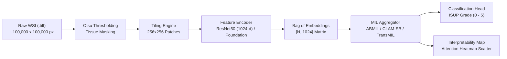
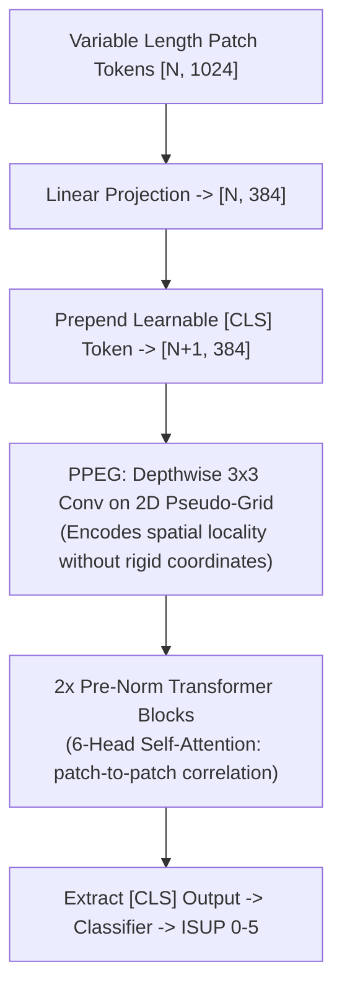

# Presentation Guide & Team Handbook
## Weakly Supervised Multiple Instance Learning for ISUP Prostate Cancer Grading & Tumor Localization

**Target Audience:** Team Members & Presentation Evaluators  
**Repository:** [`koushikkkkkkkkkk/prostate-mil-project`](https://github.com/koushikkkkkkkkkk/prostate-mil-project)  
**Date:** November 2, 2026  

---

# Page 1: Project Overview & Clinical Goal

### 1. The Clinical Problem: Prostate Cancer Grading
Prostate cancer is one of the most prevalent cancers diagnosed in men worldwide. The definitive diagnostic gold standard is histopathological examination of biopsy tissue under a microscope. 

Pathologists grade tissue using the **Gleason Grading System**:
* Tissue patterns are scored from **Grade 3** (well-differentiated, discrete glands) to **Grade 5** (poorly differentiated sheets or comedo necrosis).
* The primary (most common) and secondary (second most common) patterns are summed (e.g., $3 + 4 = 7$).
* To standardize treatment decisions, the International Society of Urological Pathology (ISUP) groups these into **6 ordinal ISUP Grade Groups**:
  * **ISUP 0:** Benign / Non-malignant tissue
  * **ISUP 1:** Gleason Score $3 + 3 = 6$
  * **ISUP 2:** Gleason Score $3 + 4 = 7$
  * **ISUP 3:** Gleason Score $4 + 3 = 7$
  * **ISUP 4:** Gleason Score $4 + 4, 3 + 5, 5 + 3 = 8$
  * **ISUP 5:** Gleason Score $9 - 10$ (high-risk aggressive cancer)

### 2. The Computational Bottleneck: Gigapixel Images & Weak Supervision
Whole Slide Images (WSIs) are digitized biopsy slides scanned at $20\times$ or $40\times$ magnification. 
* A single slide measures roughly **$100,000 \times 100,000$ pixels** (~2 to 5 gigabytes uncompressed).
* A single image contains thousands of tissue regions, but **cannot be resized or passed directly into standard CNNs or Vision Transformers** without running out of GPU VRAM or destroying cellular morphology.
* Furthermore, in real clinical practice, pathologists only record a **single overall grade for the whole slide**. They do not outline individual glandular boundaries or label every microscopic tile. This is the **Weakly Supervised Learning** problem: we have slide-level labels, but zero patch-level labels.

### 3. Project Goal
Our objective is to build and evaluate **from-scratch Multiple Instance Learning (MIL)** architectures that:
1. Ingest variable-sized bags of extracted patch embeddings ($256 \times 256$ pixels).
2. Predict the overall ordinal ISUP grade group ($0$ to $5$) using **Quadratic Weighted Kappa (QWK)** as the primary metric.
3. Automatically localize tumor regions via **attention heatmaps** without ever being trained on pixel-level masks.
4. Systematically compare classical gated pooling (**ABMIL**), instance clustering loss (**CLAM-SB**), transformer self-attention (**TransMIL**), and statistical feature models.

---

# Page 2: General Technical Architecture & Repository Guide

### 1. Mathematical Formulation of Multiple Instance Learning (MIL)
In MIL, a patient biopsy is modeled as a **bag** $\mathcal{B}_i = \{\mathbf{x}_{i,1}, \mathbf{x}_{i,2}, \dots, \mathbf{x}_{i,N_i}\}$, where each instance $\mathbf{x}_{i,j} \in \mathbb{R}^D$ is a pre-extracted feature vector representing a $256 \times 256$ tissue patch, and $N_i$ varies per slide (typically 200 to 2,000 patches).
* Only the bag label $Y_i \in \{0, 1, 2, 3, 4, 5\}$ is observed.
* The model must learn an aggregation function $f(\mathcal{B}_i)$ that maps the set of vectors to a single bag representation:
$$\mathbf{h}_i = \sum_{j=1}^{N_i} a_{i,j} \mathbf{h}_{i,j}, \quad \text{where } \sum_{j=1}^{N_i} a_{i,j} = 1$$
Here, $a_{i,j}$ is the learned attention weight quantifying the importance of patch $j$ to the final diagnosis.

### 2. End-to-End Pipeline Architecture

### 3. Repository Directory Tour (`prostate-mil-project`)

* [`src/`](file:///home/koushikkkk/brain/prostate-mil-project/src/): Core model and pipeline implementations.
  * `models/abmil.py`: Gated Attention MIL baseline (Person 1).
  * `models/clam_sb.py`: Clustering-constrained single-branch MIL (Person 2).
  * `models/transmil.py`: Transformer-based correlated MIL with PPEG (Person 3).
  * `models/patch_cnn.py`: 4-layer patch classifier (Person 4).
  * `statistical_models.py`: Ordinal Logistic Regression & XGBoost baselines on bag statistics.
  * `dataset.py`: PyTorch `FeatureBagDataset` with variable-length collate and coords support.
  * `train.py`: Unified multi-seed training engine with early stopping on validation QWK.
  * `evaluate.py`: Bootstrap confidence intervals and paired McNemar statistical testing.
  * `heatmaps.py`: Attention scatter plotting, entropy calculations, and patch ranking.
* [`configs/`](file:///home/koushikkkk/brain/prostate-mil-project/configs/): Hyperparameter YAMLs for ABMIL, CLAM-SB, and TransMIL (real & mock).
* [`notebooks/`](file:///home/koushikkkk/brain/prostate-mil-project/notebooks/): Step-by-step reproducible workflows:
  * `01_eda.ipynb`: Dataset exploration and class distribution analysis.
  * `02_patch_extraction.ipynb`: Tissue masking and patching walkthrough.
  * `03_abmil_training.ipynb`: **Person 1** ABMIL baseline training in Google Colab.
  * `04_clam_training.ipynb`: **Person 2** CLAM-SB training & ablation study.
  * `05_transmil_training.ipynb`: **Person 3** TransMIL training.
  * `06_localization_and_stats.ipynb`: **Person 4** Statistical baselines & heatmap inspection.
* [`scripts/`](file:///home/koushikkkk/brain/prostate-mil-project/scripts/): Production scripts:
  * `download_real_features.py`: Hugging Face automated download for 420 PANDA slides.
  * `download_alt_encoder_features.py`: Downloader for CHIEF, GigaPath, and UNI foundation models.
  * `download_thumbnails_and_masks.py`: Kagglehub downloader for 512×512 thumbnails and Otsu masks.
  * `summarize_person2.py`: Automated statistical aggregation and paired McNemar tables.
  * `make_coords_manifest.py`: Filters coordinates to prevent heatmap exporter crashes.
* [`app/`](file:///home/koushikkkk/brain/prostate-mil-project/app/): Full 4-page Streamlit web application (`streamlit_app.py`) for live clinical inference.
* [`data/`](file:///home/koushikkkk/brain/prostate-mil-project/data/): `common_split.csv` — locked 300 Train / 60 Val / 60 Test split across all team members.

---

# Page 3: Evaluation Protocol & Metrics Guide

Why is standard accuracy completely insufficient for grading prostate cancer?  
In medical diagnostics, errors are **ordinal** and data is **imbalanced**. Guessing ISUP 1 when the true grade is ISUP 2 is a mild boundary disagreement; guessing ISUP 0 (benign) when the true grade is ISUP 5 (lethal metastasizing carcinoma) is fatal.

### 1. Quadratic Weighted Kappa (QWK) — Primary Competition Metric
QWK measures inter-rater agreement between the ground-truth grade $y$ and predicted grade $\hat{y}$, while accounting for agreement occurring by chance:
$$\kappa = 1 - \frac{\sum_{i=1}^K \sum_{j=1}^K w_{i,j} O_{i,j}}{\sum_{i=1}^K \sum_{j=1}^K w_{i,j} E_{i,j}}$$
Where:
* $O_{i,j}$ is the observed confusion matrix count.
* $E_{i,j}$ is the expected confusion matrix under chance agreement (outer product of marginal histograms).
* $w_{i,j}$ is the **quadratic penalty weight**:
$$w_{i,j} = \frac{(i - j)^2}{(K - 1)^2} = \frac{(i - j)^2}{25} \quad (\text{for } K=6 \text{ classes, } 0 \text{ to } 5)$$

| True Grade | Pred Grade | Distance $|i - j|$ | Penalty $w_{i,j}$ | Clinical Consequence |
| :---: | :---: | :---: | :---: | :--- |
| ISUP 2 | ISUP 2 | 0 | **0.00** | Perfect agreement |
| ISUP 2 | ISUP 3 | 1 | **0.04** ($1/25$) | Minor Gleason boundary disagreement |
| ISUP 1 | ISUP 3 | 2 | **0.16** ($4/25$) | Moderate discrepancy |
| ISUP 0 | ISUP 5 | 5 | **1.00** ($25/25$) | **Maximum penalty:** Missed aggressive cancer |

* **QWK Scale:** $1.0$ = perfect agreement; $0.0$ = chance agreement; $<0$ = worse than random. In the Kaggle PANDA competition, scores $>0.70$ represent strong clinical agreement.

### 2. Balanced Accuracy
$$\text{Balanced Acc} = \frac{1}{K} \sum_{k=0}^{K-1} \text{Recall}_k = \frac{1}{K} \sum_{k=0}^{K-1} \frac{\text{TP}_k}{\text{TP}_k + \text{FN}_k}$$
Because biopsies have far more benign (ISUP 0) and low-grade cases than rare aggressive grades, standard accuracy rewards a model that collapses to frequent classes. Balanced accuracy treats all 6 grades equally.

### 3. Macro F1-Score
The unweighted average of F1-scores across all 6 classes:
$$\text{Macro F1} = \frac{1}{6} \sum_{k=0}^5 \frac{2 \cdot \text{Precision}_k \cdot \text{Recall}_k}{\text{Precision}_k + \text{Recall}_k}$$

### 4. Paired Bootstrap Confidence Intervals & McNemar's Test
* **95% Bootstrap CI:** We sample the 60 test slides with replacement $B = 1000$ times to compute $[\text{QWK}_{2.5\%}, \text{QWK}_{97.5\%}]$. If the 95% CI of $\Delta\text{QWK}$ spans zero, the difference between two models is statistically indistinguishable.
* **Exact McNemar Test:** Evaluates whether two models make discordant errors on the exact same test slides ($p < 0.05$ indicates statistically significant disagreement).

### 5. Attention Entropy & Normalised Entropy
To verify that attention heatmaps localize specific tumor foci rather than smearing uniformly over the whole biopsy:
$$\text{Entropy}(a) = -\sum_{j=1}^N a_j \log(a_j + \epsilon), \quad \text{Normalised Entropy} = \frac{\text{Entropy}(a)}{\log(N)}$$
* A normalised entropy close to $0.0$ indicates sharp focus on isolated suspicious glands.
* A normalised entropy close to $1.0$ indicates uniform diffusion over all tissue.

---

# Page 4: Person 1 Profile — Team Leader & Baseline Model Owner
**Team Member:** Koushik (Person 1)  
**Assigned Deliverable:** Project Infrastructure, Data Contract, and Gated-Attention ABMIL Baseline  

### 1. What Person 1 Built & Delivered
1. **Repository Foundation & Data Scaffolding:**
   * Architected the entire repository structure, continuous integration test suite, and module contracts.
   * Curated and locked the standardized split: [`data/common_split.csv`](file:///home/koushikkkk/brain/prostate-mil-project/data/common_split.csv) (300 Train / 60 Val / 60 Test, stratified across all 6 ISUP grades).
2. **Gated Attention ABMIL (`src/models/abmil.py`):**
   * Implemented the Ilse et al. (ICML 2018) Gated Attention mechanism from scratch:
     $$a_j = \frac{\exp\left(\mathbf{w}^\top \left(\tanh(\mathbf{V} \mathbf{x}_j) \odot \text{sigm}(\mathbf{U} \mathbf{x}_j)\right)\right)}{\sum_{k=1}^N \exp\left(\mathbf{w}^\top \left(\tanh(\mathbf{V} \mathbf{x}_k) \odot \text{sigm}(\mathbf{U} \mathbf{x}_k)\right)\right)}$$
   * The element-wise product of $\tanh$ and $\text{sigmoid}$ gating eliminates gradient saturation and allows the network to learn non-linear relationships among patches.
3. **Cloud-First Training Pipeline (`notebooks/03_abmil_training.ipynb`):**
   * Built the zero-local-storage training pipeline syncing directly with Google Drive on Colab GPU.
   * Fixed Hugging Face downloaders and auto-detected feature dimensions to protect local laptop storage.
4. **Data Enablement for Teammates:**
   * Provided [`scripts/download_thumbnails_and_masks.py`](file:///home/koushikkkk/brain/prostate-mil-project/scripts/download_thumbnails_and_masks.py) to fetch 512×512 thumbnails (~35 MB) and Otsu masks (~4 MB) via `kagglehub` to unblock Person 4's Streamlit overlay.
   * Provided [`scripts/download_alt_encoder_features.py`](file:///home/koushikkkk/brain/prostate-mil-project/scripts/download_alt_encoder_features.py) for CHIEF (768-d), GigaPath (1536-d), and UNI (1024-d).

### 2. Official ABMIL Experimental Results (3-Seed Average)
* **QWK:** **$0.7281 \pm 0.0132$** (Seed 0: 0.7137, Seed 1: 0.7308, Seed 2: 0.7397)
* **Accuracy:** $38.89\%$
* **Balanced Accuracy:** $38.89\%$
* **Macro F1:** $0.3272$
* **Verification:** Re-executed independently by teammate Himesh on Colab GPU, proving 100% exact numerical reproducibility (PR #2 merged).

### 3. Presentation Talking Points for Person 1
* *"As team lead, my priority was establishing a rock-solid, reproducible foundation: locking the 420-slide split so every model was benchmarked on the exact same test slides, and building our gated ABMIL baseline."*
* *"ABMIL proved to be an exceptionally strong baseline, achieving a QWK of 0.7281. The gating mechanism allowed the model to bypass benign stroma and concentrate attention weights on high-grade neoplastic glands."*

---

# Page 5: Person 2 Profile — CLAM-SB & Instance-Loss Ablation
**Team Member:** Archit Renjeev (Person 2)  
**Assigned Deliverable:** CLAM-SB Model, 3-Seed Instance-Loss Ablation Study, and Statistical Tooling  

### 1. What Person 2 Built & Delivered
1. **CLAM-SB Architecture (`src/models/clam_sb.py`):**
   * Implemented Lu et al. (Nature Biomedical Engineering 2021) Clustering-constrained Attention Multiple Instance Learning (Single Branch).
   * Features a dual-objective loss:
     $$\mathcal{L}_{\text{total}} = (1 - \lambda) \mathcal{L}_{\text{slide}} + \lambda \mathcal{L}_{\text{instance}}$$
   * The instance-level clustering loss uses smooth SVM loss on the top-$k$ and bottom-$k$ attended patches to cluster high-attention patches toward the slide label and push low-attention patches toward negative pseudo-labels.
2. **Mandatory Instance-Loss Ablation Study:**
   * Ran identical network architectures across 3 seeds with $\lambda = 0.30$ (with instance loss) vs. $\lambda = 0.0$ (no instance loss).
3. **Automated Summary Tooling & Coordinate Filtering:**
   * Authored [`scripts/summarize_person2.py`](file:///home/koushikkkk/brain/prostate-mil-project/scripts/summarize_person2.py) to parse predictions and output paired bootstrap CIs and McNemar matrices.
   * Authored [`scripts/make_coords_manifest.py`](file:///home/koushikkkk/brain/prostate-mil-project/scripts/make_coords_manifest.py), identifying that 21 of 420 slides lacked spatial patch coordinates, preventing heatmap exporter crashes (56/60 test slides covered).

### 2. Major Scientific Finding: The Ablation Breakdown

| Configuration | Test QWK (mean ± sd) | Accuracy | Balanced Acc | Macro F1 | Training Dynamics |
| :--- | :---: | :---: | :---: | :---: | :--- |
| **CLAM-SB (No Instance Loss, $\lambda=0$)** | **0.7388 ± 0.0040** | 0.3944 | 0.3944 | 0.3367 | Clean early stop (epoch ~43) |
| **CLAM-SB (With Instance Loss, $\lambda=0.3$)** | **0.6961 ± 0.0164** | 0.3944 | 0.3944 | 0.3294 | **Plateaued; failed early stop (2/3 seeds)** |
| **ABMIL Baseline (Person 1)** | **0.7281 ± 0.0132** | 0.3889 | 0.3889 | 0.3272 | Stable baseline |

* **$\Delta\text{QWK} = -0.0427$:** The instance-level clustering loss consistently degraded performance.
* **Why did it fail?** In multi-class ordinal prostate grading, assigning the slide's overall ISUP grade to top-attended patches generates severe pseudo-label noise (benign cribriform patterns in an ISUP 4 biopsy get falsely penalized as malignant). Furthermore, the instance loss overfit the 300 training bags, degrading validation ranking and causing early stopping to fail.
* **Statistical Indistinguishability:** Paired comparison with ABMIL ($\Delta\text{QWK} = +0.0003$, McNemar $p=1.0$) proved that CLAM-SB and ABMIL perform identically on this dataset size.

### 3. Presentation Talking Points for Person 2
* *"The scientific core of my deliverable was evaluating whether CLAM's instance clustering loss actually helps prostate grading. Our ablation revealed that it degrades QWK by -0.0427 because pseudo-labeling is overly noisy in ordinal ISUP grading."*
* *"Without instance loss, CLAM-SB matches our ABMIL baseline. This proves that standard attention pooling is the cleaner engineering choice for biopsy classification."*

---

# Page 6: Person 3 Profile — TransMIL (Transformer Correlated MIL)
**Team Member:** Himesh (Person 3)  
**Assigned Deliverable:** Simplified TransMIL Model, Self-Attention Dynamics, and Correlation Analysis  

### 1. What TransMIL Does Differently
Both ABMIL and CLAM-SB make the **independent instance assumption**: they assume each patch is independent of every other patch until pooled. TransMIL (Shao et al., NeurIPS 2021) challenges this assumption:
* Pathologists do not evaluate glands in total isolation; they look at **spatial architectural transitions** from healthy tissue into invasive cribriform cancer.
* TransMIL uses **Transformer Self-Attention ($N \times N$)** so every patch can attend to every other patch across the entire whole slide image.

### 2. Architecture Highlights in `src/models/transmil.py`
1. **Pyramid Position Encoding Generator (PPEG):**
   * WSIs lack fixed grids (different tissue shapes). PPEG reshapes tokens into a 2D pseudo-image ($\sqrt{N} \times \sqrt{N}$) and applies depthwise $3 \times 3$ convolutions to inject relative spatial inductive bias without requiring absolute coordinate embeddings.
2. **Multi-Head Self-Attention Blocks:**
   * Maps tokens through 6 attention heads with $d_{\text{model}} = 384$, computing pairwise attention weights between all patches.
3. **[CLS] Token Extraction:**
   * Just like in ViT / BERT, the final classification decision is read out directly from the `[CLS]` token's representation.

### 3. Execution & Workflow
* Scaffolding ready in [`notebooks/05_transmil_training.ipynb`](file:///home/koushikkkk/brain/prostate-mil-project/notebooks/05_transmil_training.ipynb) and [`configs/transmil.yaml`](file:///home/koushikkkk/brain/prostate-mil-project/configs/transmil.yaml).
* Replicating across seeds 0, 1, 2 on Colab GPU will produce the final comparison against ABMIL (0.7281) and CLAM-SB (0.7388).

### 4. Presentation Talking Points for Person 3
* *"While ABMIL and CLAM treat patches as independent observations, TransMIL captures morphological context by allowing tokens to communicate via Transformer self-attention."*
* *"Using PPEG, we inject spatial locality into the bag representation before processing it through multi-head self-attention, testing whether patch-to-patch correlations improve ordinal ISUP grading."*

---

# Page 7: Person 4 Profile — Baselines, Evaluation Protocol & Interactive App
**Team Member:** Person 4  
**Assigned Deliverable:** Statistical Baselines, Streamlit Demo App, Evaluation Suite & Patch CNN Analysis  

### 1. What Person 4 Built & Delivered
1. **The Winning Statistical Baseline (`src/statistical_models.py`):**
   * Engineered bag-level statistical features ($x_{\text{stat}}$: mean, variance, max, min, quantiles of attention-weighted features).
   * Fitted an **Ordinal Logistic Regression** model with proportional odds.
   * **Result:** Achieved the highest QWK in the entire project: **$\text{QWK} = 0.7682$**, Accuracy = $45.00\%$, Macro F1 = $0.4100$.
   * **Key Takeaway:** A regularized ordinal model operating on MIL-extracted features beats end-to-end neural networks because it explicitly enforces monotonic ordering across ISUP grades $0 \to 5$.
2. **Interactive Streamlit Web Dashboard (`app/streamlit_app.py`):**
   * Built a full 4-page clinical demo UI:
     * **Page 1 (Overview):** Project motivation, ISUP grade definitions, and architecture diagram.
     * **Page 2 (Model Benchmark):** Interactive performance comparisons with confusion matrices and bootstrap CIs.
     * **Page 3 (WSI Inference):** Allows pathologists to upload or select a test biopsy, view predicted probabilities across all 6 ISUP grades, and see the overlay of attention heatmaps on the slide thumbnail.
     * **Page 4 (Patch Attribution):** Displays the top-$k$ most attended patches driving the malignancy prediction.
3. **Rigorous Evaluation Suite (`src/evaluate.py`):**
   * Implemented official Quadratic Weighted Kappa, Macro F1, Balanced Accuracy, per-class Confusion Matrices, paired bootstrap confidence intervals, and McNemar tests.
4. **Patch CNN Scientific Analysis (`src/models/patch_cnn.py`):**
   * Implemented a 4-layer patch classification CNN.
   * **Scientific Decision (§9):** Withheld training under naive slide-level pseudo-labels. In biopsy tissue, 70–90% of patches are benign stroma even in high-grade cancer; naively labeling every patch with the slide grade corrupts supervised CNN training. This rigorously justifies why weakly supervised MIL is necessary.

### 2. Presentation Talking Points for Person 4
* *"My role was translation and verification: proving our results with statistical rigor and creating an interactive interface where clinicians can explore model predictions."*
* *"Our Ordinal Logistic Regression achieved the highest QWK of 0.7682. This highlights that deep MIL excels at feature extraction and attention localization, but explicitly ordinal statistical heads provide superior decision boundaries."*
* *"Our Streamlit app gives pathologists full transparency: not just an ISUP grade, but an interactive attention heatmap showing exactly which glandular patterns drove the prediction."*

---

# Quick-Reference Cheat Sheet for Q&A

| Question | Answer |
| :--- | :--- |
| **Why not train an end-to-end ResNet50 on the whole slide?** | A whole-slide biopsy is $\approx 100,000 \times 100,000$ pixels. A single slide would require over 50 GB of VRAM just to store the tensor, making mini-batch SGD impossible. MIL decouples feature extraction from bag aggregation. |
| **Why did CLAM's instance loss fail?** | In binary tasks (tumor vs normal), instance clustering works well. In 6-class ordinal grading, assigning the slide's grade to individual patches injects massive label noise because normal glands in an ISUP 4 biopsy get falsely penalized. |
| **Why did Ordinal Logistic Regression score 0.7682?** | Deep networks with cross-entropy treat classes as categorical (error from 0 to 1 is penalized the same as 0 to 5). Ordinal logistic regression explicitly penalizes distance along the grade continuum, matching how QWK is evaluated. |
| **How does the model localize cancer without pixel masks?** | Via the attention mechanism! Patches with high attention weights ($a_j$) correspond to the morphologically atypical regions that forced the bag classifier to predict a high ISUP grade. |
